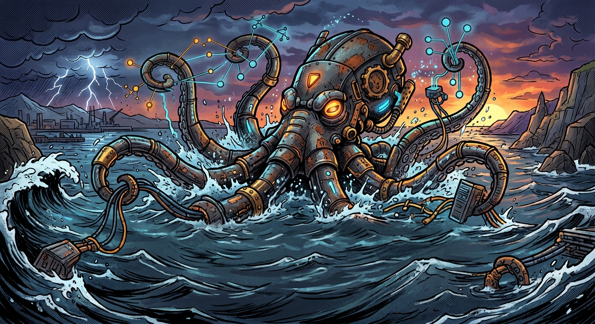

# 🦑 rustyKraken

[](https://github.com/peopleandpixel/rustyKraken/releases/tag/v0.26.0)
[](https://opensource.org/licenses/GPL-3.0)
[](https://www.rust-lang.org/)
[](https://github.com/peopleandpixel/rustyKraken/actions/workflows/ci.yml)



A centralized message hub written in Rust that collects messages from various sources, sorts them by topic, and routes them to actions.

## Concept

rustyKraken follows the kraken metaphor:

- **Tentacles** (Arms) – Reach into various sources (email, MQTT, HTTP, ntfy, ...) and fetch messages
- **Ink** (Ink) – The unified message format that all sources are converted into
- **Mantle** (Mantle) – SQLite-based storage for all messages
- **Reflexes** (Reflexes) – React to specific topics and trigger actions

## Architecture

```
┌──────────────────────────────────────────────────┐
│                 rustyKraken Core                 │
│                                                  │
│  ┌──────────┐    ┌──────────────┐    ┌─────────┐ │
│  │Tentacles │──▶│  Event Bus   │──▶│Reflexes │ │
│  │(Sources) │    │  (Routing)   │    │(Actions)│ │
│  └──────────┘    └──────────────┘    └─────────┘ │
│       │                  │                │      │
│       ▼                  ▼                ▼      │
│  config/incoming/   Mantle/DB       config/      │
│  (YAML)                              listener/   │
│                                          (YAML)  │
└──────────────────────────────────────────────────┘
```

## Quick Start

### Installation

```bash
cargo build --release
./target/release/rustyKraken
```

### Configuration

#### Tentacles (Incoming Sources)

Create YAML files in `config/incoming/`:

**HTTP Webhook** (`config/incoming/http_webhook.yaml`):
```yaml
name: "webhook_example"
type: "http"
config:
  host: "127.0.0.1"
  port: 8080
  path: "/webhook"
```

Test with:
```bash
curl -X POST http://127.0.0.1:8080/webhook \
  -H "Content-Type: application/json" \
  -d '{"topic": "/kraken/warning", "body": "Temperatur zu hoch: 42°C"}'
```

**MQTT** (`config/incoming/mqtt_kraken.yaml`):
```yaml
name: "mqtt_kraken"
type: "mqtt"
config:
  broker: "localhost"
  port: 1883
  use_tls: false
  username: "user"
  password: "secret"
  topics:
    - "kraken/+"
  topic_mapping:
    "kraken/warning": "/kraken/warning"
  last_will:
    topic: "kraken/status"
    message: "offline"
    qos: 1
  clean_session: true
  reconnect_delay_ms: 5000
  max_reconnect_attempts: 10
```

**IMAP** (`config/incoming/imap_email.yaml`):
```yaml
name: "work_email"
type: "imap"
config:
  host: "imap.example.com"
  port: 993
  username: "user@example.com"
  password: "${EMAIL_PASSWORD}"
  use_tls: true
  starttls: false
  mailbox: "INBOX"
  poll_interval_seconds: 30
  use_idle: true
  mark_as_read: true
  move_to_mailbox: "Processed"
  topic_mode:
    mode: "subject"
    fallback_topic: "/email/inbox"
```

**POP3** (`config/incoming/pop3_email.yaml`):
```yaml
name: "pop3_email"
type: "pop3"
config:
  host: "pop.example.com"
  port: 995
  username: "user@example.com"
  password: "${EMAIL_PASSWORD}"
  use_tls: true
  starttls: false
  poll_interval_seconds: 60
  delete_after_processing: false
  topic_mode:
    mode: "subject"
    fallback_topic: "/email/inbox"
```

**ntfy** (`config/incoming/ntfy_kraken.yaml`):
```yaml
name: "ntfy_kraken"
type: "ntfy"
config:
  server: "https://ntfy.sh"
  topics:
    - "kraken/alerts"
    - "kraken/status"
  connection_type: "json"  # or "websocket"
  topic_mapping:
    "kraken/alerts": "/kraken/alerts"
    "kraken/status": "/kraken/status"
  reconnect_delay: 5
```

**SMTP** (`config/incoming/smtp_server.yaml`):
```yaml
name: "smtp_receiver"
type: "smtp"
config:
  host: "0.0.0.0"
  port: 2525
  server_name: "rustyKraken"
  max_message_size: 10485760
  require_auth: false
  tls_cert: "path/to/cert.pem"
  tls_key: "path/to/key.pem"
  topic_mode:
    mode: "subject"
    fallback_topic: "/email/incoming"
```

**Telegram** (`config/incoming/telegram.yaml`):
```yaml
name: "telegram_bot"
type: "telegram"
config:
  bot_token: "123456:ABC-DEF..."
  connection_type: "polling"  # or "webhook"
  topic_mode: "all"           # command, content, chat, or all
  fallback_topic: "/telegram/default"
  chat_topic_mapping:
    "100": "/kraken/alerts"
  allowed_chats: []           # empty = accept all
  allowed_users: []           # empty = accept all
```

**Discord** (`config/incoming/discord.yaml`):
```yaml
name: "discord_bot"
type: "discord"
config:
  connection_type: "bot"      # or "webhook"
  bot_token: "MTAw..."        # Discord bot token
  topic_mode: "all"           # channel, content, or all
  fallback_topic: "/discord/default"
  channel_topic_mapping:
    "123456789": "/kraken/alerts"
  allowed_channels: []        # empty = accept all
  allowed_guilds: []          # empty = accept all
  allowed_users: []           # empty = accept all
```

**File Watcher** (`config/incoming/file_watcher.yaml`):
```yaml
name: "file_watcher"
type: "file_watcher"
config:
  folders:
    - path: "/watch/inbox"
      topic: "/files/inbox"
      recursive: false
  file_extensions: [".txt", ".json"]
  topic_mode: "all"           # folder, filename, content, or all
  fallback_topic: "/files/default"
  post_process: "move"        # none, delete, or move
  move_to: "/watch/processed"
```

**Stdin** (`config/incoming/stdin.yaml`):
```yaml
name: "stdin_listener"
type: "stdin"
config:
  format: "auto"              # plain, json, or auto
  topic_mode: "content"       # content or all
  fallback_topic: "/stdin/default"
```

**Serial Port** (`config/incoming/serial.yaml`):
```yaml
name: "serial_sensor"
type: "serial"
config:
  ports:
    - port: "/dev/ttyUSB0"
      baud_rate: 9600
      data_bits: 8
      parity: "none"
      stop_bits: 1
      topic: "/serial/sensor"
      parser: "plain"       # plain, json, csv, custom
  reconnect_delay: 5
  buffer_size: 4096
  port_topic_mapping:
    "/dev/ttyUSB1": "/serial/actuator"
```

**SNMP Trap** (`config/incoming/snmp.yaml`):
```yaml
name: "snmp_traps"
type: "snmp"
config:
  listen_address: "0.0.0.0:1162"
  community: "public"
  version: "v2c"            # v1, v2c, v3
  topic: "/snmp/trap"
  oid_topic_mapping:
    "1.3.6.1.6.3.1.1.5.2": "/snmp/linkdown"
    "1.3.6.1.6.3.1.1.5.3": "/snmp/linkup"
  max_packet_size: 65535
```

**AWS SQS** (`config/incoming/aws_sqs.yaml`):
```yaml
name: "sqs_consumer"
type: "aws_sqs"
config:
  region: "eu-central-1"
  queue_url: "https://sqs.eu-central-1.amazonaws.com/123456789/my-queue"
  poll_interval: 5
  max_messages: 10
  visibility_timeout: 30
  delete_after_processing: true
  topic_mode: "all"           # attribute, body, or all
  fallback_topic: "/sqs/default"
  queue_topic_mapping:
    "https://sqs.eu-central-1.amazonaws.com/123456789/alerts": "/sqs/alerts"
```

**Google Pub/Sub** (`config/incoming/google_pubsub.yaml`):
```yaml
name: "pubsub_listener"
type: "google_pubsub"
config:
  project_id: "my-project"
  subscription: "my-subscription"
  poll_interval: 5
  max_messages: 10
  auto_ack: true
  topic_mode: "all"           # attribute, data, or all
  fallback_topic: "/pubsub/default"
  topic_mapping:
    "my-subscription": "/pubsub/mapped"
```

**Slack** (`config/incoming/slack.yaml`):
```yaml
name: "slack_listener"
type: "slack"
config:
  signing_secret: "your-signing-secret"
  host: "0.0.0.0"
  port: 9880
  path: "/slack/events"
  topic_mode: "all"           # channel, content, or all
  fallback_topic: "/slack/default"
  channel_topic_mapping:
    "C123456": "/slack/alerts"
  allowed_channels: []        # empty = all
  allowed_users: []           # empty = all
```

**Cron/Scheduler** (`config/incoming/cron.yaml`):
```yaml
name: "scheduler"
type: "cron"
config:
  startup_delay_secs: 0
  jobs:
    - name: "heartbeat"
      schedule: "*/5 * * * *"
      topic: "/cron/heartbeat"
      body: "Heartbeat check"
      metadata:
        check_type: "heartbeat"
    - name: "daily_report"
      schedule: "0 0 * * *"
      topic: "/cron/daily"
```

**REST API Poller** (`config/incoming/rest_api.yaml`):
```yaml
name: "api_poller"
type: "rest_api"
config:
  endpoints:
    - url: "https://api.example.com/data"
      method: "GET"
      topic: "/api/data"
      json_path: "data.items"
      auth:
        type: "bearer"
        token: "my-token"
  interval_seconds: 60
  max_retries: 3
  rate_limit_per_minute: 10
```

**WebSocket** (`config/incoming/websocket.yaml`):
```yaml
name: "ws_listener"
type: "websocket"
config:
  url: "wss://example.com/ws"
  topic_mode: "field"         # field, content, or all
  topic_field: "event_type"
  body_field: "payload"
  fallback_topic: "/ws/default"
  reconnect: true
  reconnect_delay_seconds: 5
```

**RSS/Atom Feed** (`config/incoming/rss.yaml`):
```yaml
name: "feed_reader"
type: "rss"
config:
  feeds:
    - url: "https://example.com/feed.xml"
      feed_type: "auto"       # auto, rss, or atom
    - url: "https://example.com/atom.xml"
      topic: "/feed/custom"
  interval_seconds: 300
  topic_mode: "feedtitle"
  fallback_topic: "/rss/default"
```

#### Reflexes (Actions)

Create YAML files in `config/listener/`:

**File Logging** (`config/listener/file_log.yaml`):
```yaml
name: "log_warnings"
trigger:
  topics:
    - "/kraken/warning"
    - "/home/emergency"
action:
  type: "file"
  config:
    path: "data/warnings.log"
    mode: "append"
```

**Shell Command** (`config/listener/command_echo.yaml`):
```yaml
name: "echo_warning"
trigger:
  topics:
    - "/kraken/**"
action:
  type: "command"
  config:
    command: "echo"
    args: ["Nachricht erhalten"]
```

Available environment variables:
- `INK_JSON` – The entire message as JSON
- `INK_TOPIC` – The topic
- `INK_BODY` – The body content
- `INK_ID` – The UUID

**WhatsApp** (`config/listener/whatsapp_alerts.yaml`):
```yaml
name: "whatsapp_alerts"
trigger:
  topics:
    - "/kraken/alerts/**"
action:
  type: "whatsapp"
  config:
    access_token: "EAA..."
    phone_number_id: "1234567890"
    recipients:
      - "+1234567890"
    message_type: "text"
    body_template: "Alert: {{body}}"
    language: "en_US"
```

**Tentacle (Filter/Forward)** (`config/listener/forward_alerts.yaml`):
```yaml
name: "forward_alerts"
trigger:
  topics:
    - "/sensor/**"
action:
  type: "tentacle"
  config:
    target_topic: "/forwarded/{{topic}}"
    body_template: "[{{topic}}] {{body}}"
    topic_mapping:
      "/sensor/temp": "/iot/temperature"
    topic_prefix_mapping:
      "/sensor/": "/iot/sensor/"
    body_filter: ".*alert.*"
    preserve_metadata: true
    add_metadata:
      forwarded_by: "tentacle-reflex"
```

**Discord** (`config/listener/discord_alerts.yaml`):
```yaml
name: "discord_alerts"
trigger:
  topics:
    - "/kraken/alerts/**"
action:
  type: "discord"
  config:
    webhook_url: "https://discord.com/api/webhooks/123/abc"
    content_template: "Alert: {{body}}"
    use_embeds: true
    embed_title: "{{topic}}"
    embed_color: 16711680
    embed_footer: "rustyKraken"
    username: "Kraken Bot"
    topic_webhook_mapping:
      "/kraken/critical": "https://discord.com/api/webhooks/456/def"
    topic_color_mapping:
      "/kraken/critical": 16711680
      "/kraken/info": 65280
    include_metadata: true
```

**ntfy** (`config/listener/ntfy_alerts.yaml`):
```yaml
name: "ntfy_alerts"
trigger:
  topics:
    - "/kraken/alerts/**"
action:
  type: "ntfy"
  config:
    server: "https://ntfy.sh"
    topic: "kraken-alerts"
    title_template: "[{{topic}}] Alert"
    message_template: "{{body}}"
    priority: 5
    tags: ["fire", "warning"]
    markdown: true
    topic_mapping:
      "/kraken/critical": "kraken-critical"
    topic_priority_mapping:
      "/kraken/critical": 5
```

**Telegram** (`config/listener/telegram_alerts.yaml`):
```yaml
name: "telegram_alerts"
trigger:
  topics:
    - "/kraken/alerts/**"
action:
  type: "telegram"
  config:
    bot_token: "123456:ABC-DEF"
    chat_ids:
      - "-1001234567890"
    parse_mode: "Markdown"
    body_template: "*Alert:* {{body}}"
    topic_chat_mapping:
      "/kraken/critical": ["-1009876543210"]
    include_metadata: false
```

**E-Mail** (`config/listener/email_alerts.yaml`):
```yaml
name: "email_alerts"
trigger:
  topics:
    - "/kraken/alerts/**"
action:
  type: "email"
  config:
    smtp_host: "smtp.gmail.com"
    smtp_port: 587
    smtp_user: "alerts@gmail.com"
    smtp_password: "app_password"
    from_email: "alerts@gmail.com"
    from_name: "Kraken Alerts"
    to_emails:
      - "admin@example.com"
    subject_template: "[{{topic}}] {{body}}"
    body_template: "Topic: {{topic}}\nBody: {{body}}\nTime: {{timestamp}}"
    html_body: false
    topic_recipient_mapping:
      "/kraken/critical": ["oncall@example.com"]
```

**HTTP/Webhook** (`config/listener/http_webhook.yaml`):
```yaml
name: "http_webhook"
trigger:
  topics:
    - "/kraken/alerts/**"
action:
  type: "http"
  config:
    url: "https://hooks.example.com/kraken"
    method: "POST"
    content_type: "application/json"
    body_template: '{"topic":"{{topic}}","body":"{{body}}","timestamp":"{{timestamp}}"}'
    auth:
      type: "bearer"
      token: "secret-token"
    retries: 3
    retry_delay_ms: 1000
    topic_url_mapping:
      "/kraken/critical": "https://hooks.example.com/critical"
```

**Matrix/Element** (`config/listener/matrix_alerts.yaml`):
```yaml
name: "matrix_alerts"
trigger:
  topics:
    - "/kraken/alerts/**"
action:
  type: "matrix"
  config:
    server: "https://matrix.org"
    access_token: "your_access_token"
    room_id: "!roomid:matrix.org"
    msg_type: "notice"
    body_template: "*{{topic}}*: {{body}}"
    formatted_body_template: "<b>{{topic}}</b>: {{body}}"
    format: "html"
    topic_room_mapping:
      "/kraken/critical": "!critical:matrix.org"
```

**Syslog** (`config/listener/syslog_alerts.yaml`):
```yaml
name: "syslog_alerts"
trigger:
  topics:
    - "/kraken/alerts/**"
action:
  type: "syslog"
  config:
    server: "syslog.example.com"
    port: 514
    connection_type: "udp"    # or "tcp"
    facility: "local0"
    severity: "warning"
    message_template: "[{{topic}}] {{body}}"
    rfc5424: false
    topic_severity_mapping:
      "/kraken/critical": "emergency"
```

**Home Assistant** (`config/listener/home_assistant_alerts.yaml`):
```yaml
name: "home_assistant_alerts"
trigger:
  topics:
    - "/kraken/alerts/**"
action:
  type: "home_assistant"
  config:
    server: "http://homeassistant.local:8123"
    access_token: "eyJ..."
    action_type: "event"       # or "service"
    event_name: "rustykraken_alert"
    message_template: "{{body}}"
    title_template: "{{topic}}"
    topic_event_mapping:
      "/kraken/critical": "critical_alert"
    topic_service_mapping:
      "/notify/phone": "notify/mobile_app_phone"
```

**Database** (`config/listener/database_store.yaml`):
```yaml
name: "database_store"
trigger:
  topics:
    - "/**"
action:
  type: "database"
  config:
    database_type: "sqlite"        # sqlite, postgres, or mysql
    connection_string: "data/kraken_archive.db"
    table_name: "ink_messages"
    auto_create_table: true
    max_connections: 10
    include_metadata: true
    include_status: true
```

**Aggregator** (`config/listener/sensor_aggregator.yaml`):
```yaml
name: "sensor_aggregator"
trigger:
  topics:
    - "/sensor/**"
action:
  type: "aggregator"
  config:
    window_seconds: 300             # 5 minutes
    groups:
      - name: "temp_count"
        topic_pattern: "/sensor/temp/**"
        function: count
        output_topic: "/aggregated/temp/count"
      - name: "temp_avg"
        topic_pattern: "/sensor/temp/**"
        function: average
        value_field: "value"
        output_topic: "/aggregated/temp/avg"
    body_template: "{{count}} messages, avg={{average}}"
    include_breakdown: true
```

**Script** (`config/listener/process_script.yaml`):
```yaml
name: "process_script"
trigger:
  topics:
    - "/sensor/**"
action:
  type: "script"
  config:
    language: "python"
    script_path: "/opt/scripts/process.py"
    capture_stdout: true
    publish_output: true
    output_topic: "/script/{{topic}}/output"
    env:
      API_KEY: "secret"
```

**File Write** (`config/listener/file_output.yaml`):
```yaml
name: "file_output"
trigger:
  topics:
    - "/sensor/**"
action:
  type: "file"
  config:
    path: "/var/log/kraken/sensors.log"
    format: "csv"
    mode: "append"
    csv:
      columns: ["{{timestamp}}", "{{topic}}", "{{body}}"]
      header: true
      delimiter: ","
    rotation:
      max_size_bytes: 10485760
      max_files: 5
      suffix: ".old"
```

## Topics

Messages are sorted by a path-based topic system:

```
/kraken/
├── warning/
├── status/
└── data/

/home/
├── lights/
└── temperature/
```

### Wildcards

- `/kraken/**` – Matches `/kraken/warning`, `/kraken/data/sensor`, etc.
- `/kraken/*` – Matches `/kraken/warning`, but not `/kraken/data/sensor`

## Message Schema (Ink)

```json
{
  "id": "uuid-v4",
  "timestamp": "2024-11-11T10:00:00Z",
  "topic": "/kraken/warning",
  "source": {
    "type": "mqtt",
    "name": "kraken_sensors"
  },
  "body": "Temperatur zu hoch: 42°C",
  "metadata": null,
  "status": "new"
}
```

## Planned Features

### Tentacles
- [x] File Watcher Tentacle
- [x] Stdin Tentacle
- [x] Telegram Bot Tentacle
- [x] Discord Bot Tentacle
- [x] REST API Poller Tentacle
- [x] WebSocket Tentacle
- [x] RSS/Atom Feed Tentacle
- [x] Serial Port Tentacle
- [x] SNMP Trap Tentacle
- [x] AWS SQS Tentacle
- [x] Google Pub/Sub Tentacle
- [x] Slack Tentacle
- [x] Cron/Scheduler Tentacle

### Reflexes
- [x] Telegram Bot Reflex
- [x] Discord Webhook Reflex
- [x] ntfy Reflex
- [x] WhatsApp Reflex
- [x] Tentacle Reflex (Filter/Forward)
- [x] Email (SMTP) Reflex
- [x] HTTP/Webhook Reflex
- [x] Matrix/Element Reflex
- [x] Syslog Reflex
- [x] Home Assistant Reflex
- [x] Database Reflex
- [x] Aggregator Reflex
- [x] Script Reflex
- [x] File Write Reflex (JSON, CSV, plaintext, XML)

### General
- [ ] Web UI for message overview
- [ ] Hot-reload for configuration files
- [ ] Template engine for messages (`{{message.body}}`)
- [ ] Authentication for webhooks
- [ ] Plugin system for dynamic loading
- [x] Event Bus optimizations (configurable channel size, priority queue, backpressure, metrics)
- [ ] Monitoring and health checks
- [ ] Docker image

## Version

Current version: **0.26.0** (2026-11-11)

See [CHANGELOG.md](CHANGELOG.md) for detailed changes.

## Contributors

- **Jens Reinemuth** – Creator and maintainer

## License

[GPL v3 or later](LICENSE) © 2025 peopleandpixel

## Repository

[GitHub](https://github.com/peopleandpixel/rustyKraken) · [Issues](https://github.com/peopleandpixel/rustyKraken/issues) · [Releases](https://github.com/peopleandpixel/rustyKraken/releases)
